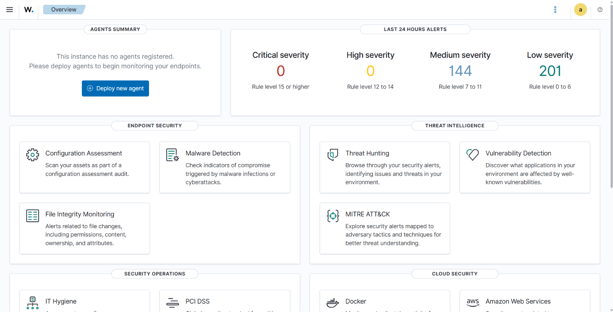
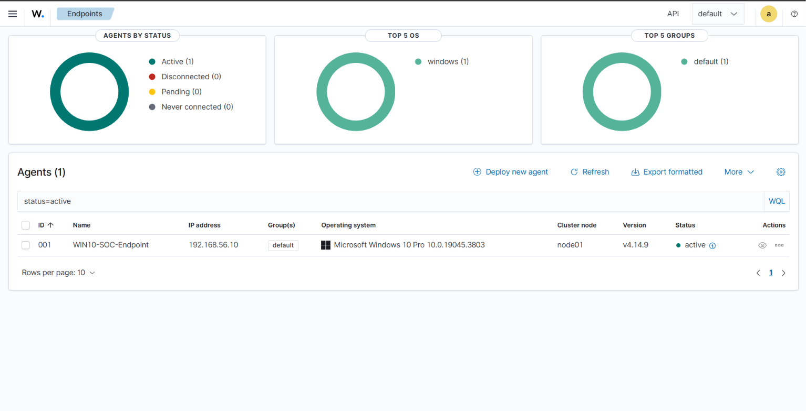
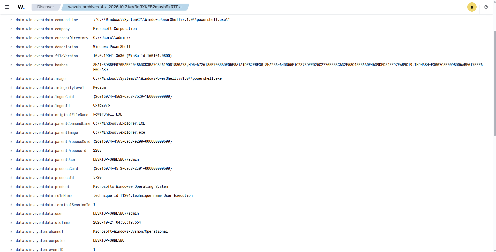
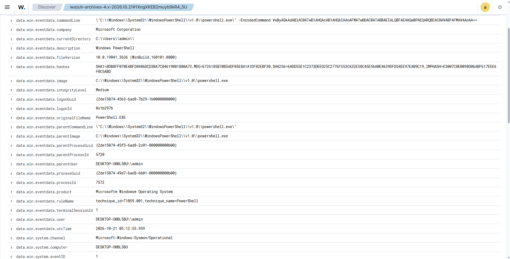
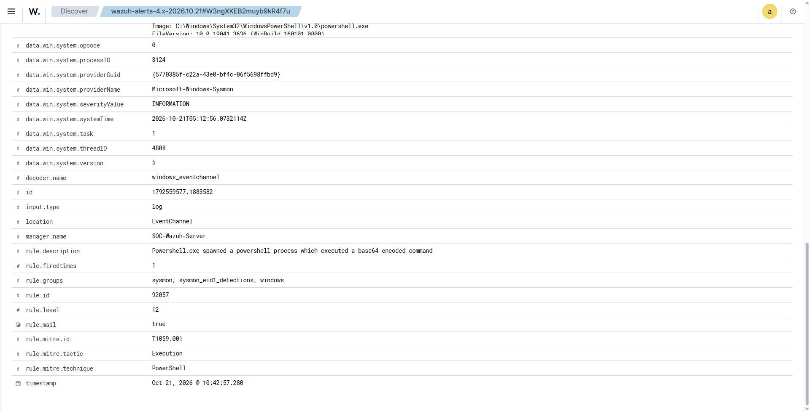
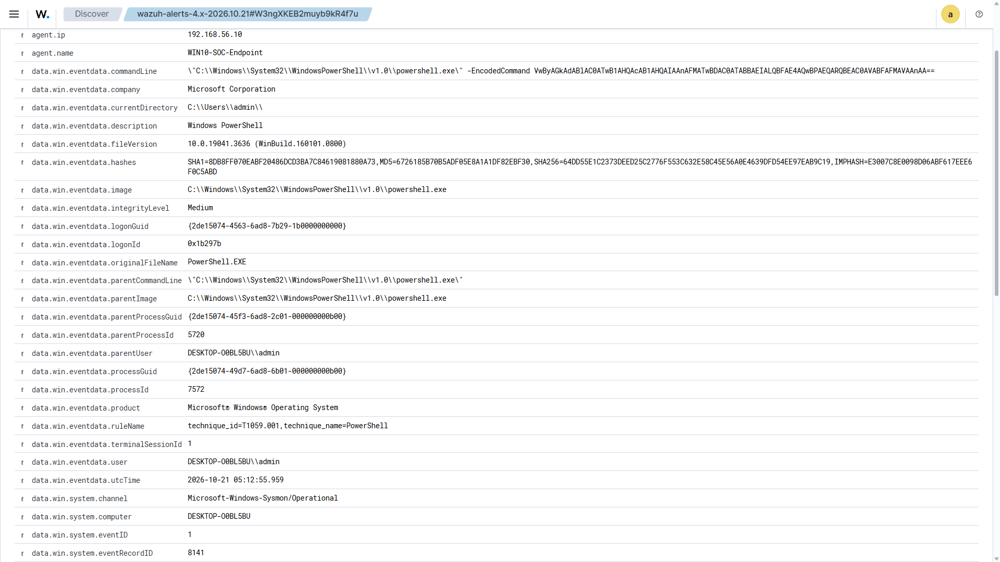
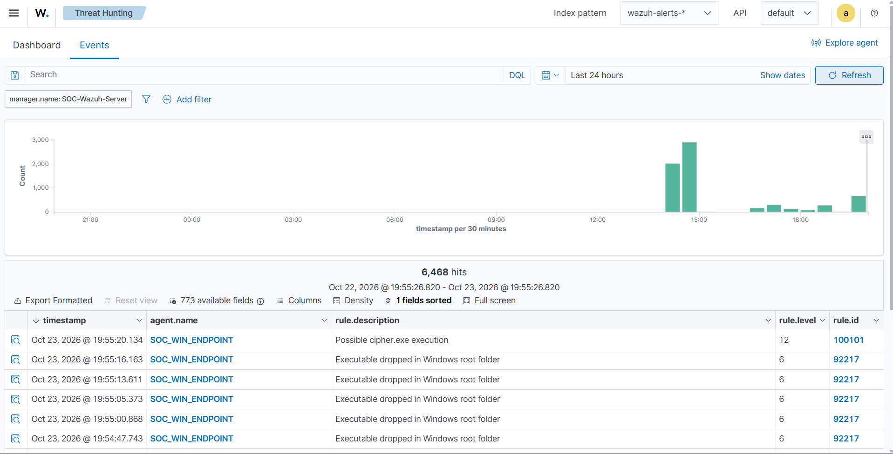
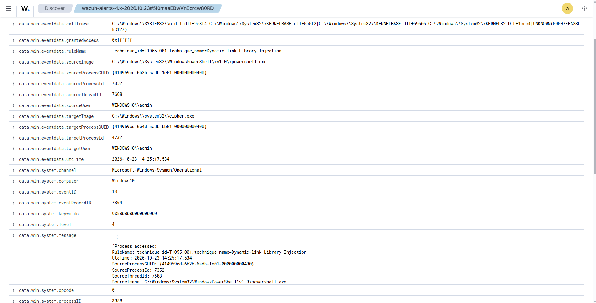

# Windows SOC Detection & Investigation Lab

## Overview

A hands-on Security Operations Center (SOC) lab built to demonstrate Windows endpoint monitoring, security telemetry collection, detection, alert validation, and event investigation using **Wazuh and Sysmon**.

The lab consists of a Windows endpoint generating Sysmon telemetry, a Wazuh agent collecting the events, and a Wazuh server providing centralized monitoring and detection.

The project also includes a custom Wazuh detection rule that was created and successfully validated in the lab environment.

---

## Objectives

- Deploy a Wazuh SIEM environment.
- Connect a Windows endpoint to Wazuh.
- Install and configure Sysmon.
- Forward Sysmon events to Wazuh.
- Analyze Windows process creation and PowerShell activity.
- Investigate raw Windows security telemetry.
- Create a custom Wazuh detection rule.
- Validate the detection using controlled test activity.
- Document the resulting alerts and evidence.

---

## Lab Architecture

```text
                    SOC LAB

        ┌──────────────────────────────┐
        │         Windows 10           │
        │                              │
        │   Sysmon + Wazuh Agent       │
        │   192.168.56.10              │
        └──────────────┬───────────────┘
                       │
                       │ Security Telemetry
                       ▼
        ┌──────────────────────────────┐
        │        Ubuntu Server         │
        │                              │
        │   Wazuh Manager              │
        │   Wazuh Indexer              │
        │   Wazuh Dashboard            │
        │   192.168.56.20              │
        └──────────────────────────────┘
```

### Lab Environment

| Component | Details |
|---|---|
| SIEM | Wazuh |
| Endpoint | Windows 10 |
| Telemetry | Sysmon |
| Server OS | Ubuntu Server |
| Virtualization | Oracle VirtualBox |
| Network | Host-only isolated network |
| Windows IP | `192.168.56.10` |
| Wazuh IP | `192.168.56.20` |

---

## Technologies Used

- Wazuh
- Wazuh Manager
- Wazuh Indexer
- Wazuh Dashboard
- Sysmon
- Windows Event Logs
- Ubuntu Server
- Windows 10
- VirtualBox

---

# 1. Wazuh Deployment

Wazuh was deployed on an Ubuntu Server virtual machine.

The deployment included:

- Wazuh Manager
- Wazuh Indexer
- Wazuh Dashboard

The Wazuh Dashboard was used to monitor the Windows endpoint and analyze collected security events.

### Evidence



---

# 2. Windows Endpoint Integration

A Windows 10 endpoint was configured with the Wazuh Agent and connected to the Wazuh server.

The Windows endpoint used the host-only address:

```text
192.168.56.10
```

The Wazuh server used:

```text
192.168.56.20
```

After successful registration and connection, the Windows endpoint appeared as an active agent in the Wazuh Dashboard.

### Evidence



---

# 3. Sysmon Integration

Sysmon was installed on the Windows endpoint to provide detailed process and system telemetry.

The Wazuh Agent was configured to collect events from:

```text
Microsoft-Windows-Sysmon/Operational
```

The collected Sysmon telemetry included events such as:

- Process Creation
- Network Connection
- Image/DLL Loading
- Process Access
- File Creation
- Registry Changes
- DNS Queries

This provided additional endpoint visibility beyond standard Windows event logging.

---

# 4. Process Creation Investigation

Sysmon **Event ID 1 — Process Create** was investigated through Wazuh.

A Notepad process was used as a controlled example to examine the information available in a process creation event.

The event provided fields including:

- Process image
- Command line
- Parent process
- User
- Process ID
- Process GUID
- File hashes

### Evidence


---

# 5. PowerShell Monitoring

PowerShell activity was also monitored through Sysmon and Wazuh.

The process creation telemetry provided information such as:

- PowerShell executable path
- Command line
- Parent process
- User
- Process ID
- Process GUID
- File hashes

### Evidence



---

# 6. Encoded PowerShell Test

A controlled encoded PowerShell command was executed in the lab to generate and observe PowerShell telemetry.

The test used PowerShell's:

```text
-EncodedCommand
```

parameter.

The resulting activity was captured by Sysmon and forwarded to Wazuh, where the event could be reviewed and investigated.

> This was a controlled test performed within the isolated lab environment for detection and monitoring practice.

### Evidence







---

# 7. Custom Detection Engineering

A custom Wazuh detection rule was created to identify a defined condition involving:

```text
cipher.exe
```

The rule was configured to generate a **Level 12 Wazuh alert** when the specified condition was observed.

The rule is included in:

```text
detection/custom-rule.xml
```

### Detection Validation

The detection was validated by executing:

```text
cipher.exe
```

from PowerShell within the Windows lab environment.

The custom rule successfully matched the resulting telemetry and generated a Wazuh alert.

### Evidence




---

# 8. Detection Workflow

The overall workflow demonstrated by this project was:

```text
Windows Activity
       ↓
Sysmon Telemetry
       ↓
Wazuh Agent
       ↓
Wazuh Manager
       ↓
Detection Rule
       ↓
Wazuh Alert
       ↓
Event Investigation
```

The successful alert confirmed that the custom detection rule was receiving and matching the expected telemetry.

---

# 9. Skills Demonstrated

This project provided hands-on experience with:

- SOC monitoring
- SIEM deployment
- Windows endpoint monitoring
- Sysmon telemetry
- Windows Event Channels
- Process creation analysis
- PowerShell monitoring
- Raw event analysis
- Custom detection engineering
- Alert validation
- Security event investigation
- Basic MITRE ATT&CK context

---

# 10. Key Takeaways

This project demonstrated how endpoint activity can be transformed into actionable security telemetry within a SOC environment.

The lab provided practical experience with the complete monitoring workflow:

```text
Endpoint Activity
       ↓
Telemetry Collection
       ↓
SIEM Processing
       ↓
Detection
       ↓
Alert
       ↓
Investigation
```

A custom detection was also created and successfully tested rather than relying only on pre-existing SIEM detections.

---

## Evidence

All project screenshots are available in the [`screenshots`](./screenshots) directory.

The custom Wazuh detection rule is available in the [`detection`](./detection) directory.

---

## Disclaimer

This project was performed in an isolated personal lab environment for cybersecurity learning and detection-engineering practice.

All test activities were controlled and performed on systems used for this lab.

---

## Project Status

**Completed ✅**

The project successfully demonstrated Windows endpoint telemetry collection, Sysmon integration, security event investigation, custom detection creation, and detection validation using Wazuh and Sysmon.