# Project 3 — Phishing Investigation & IOC Enrichment

## Overview

A hands-on SOC investigation of a synthetic phishing email. The project demonstrates email header analysis, IOC extraction, threat-intelligence enrichment, phishing indicator identification, MITRE ATT&CK mapping, and investigation reporting.

> **Note:** This project uses a synthetic training email. The domains and IP address are reserved or fictional and were not treated as real malicious infrastructure.

## Investigation Workflow

```text
Suspicious Email
       ↓
Email/Header Analysis
       ↓
IOC Extraction
       ↓
IOC Enrichment
       ↓
Phishing Indicator Analysis
       ↓
MITRE ATT&CK Mapping
       ↓
SOC Investigation Report
```

## Tools & Technologies

- Python
- Python `email` module
- Regular expressions
- Email header analysis
- IOC extraction
- Threat intelligence concepts
- MITRE ATT&CK

## Key Findings

The investigation identified:

- Sender-domain inconsistency
- Reply-To mismatch
- SPF softfail
- DKIM not present
- DMARC failure
- Urgency and account-suspension language
- Password-reset/verification theme
- Visible URL and actual hyperlink destination mismatch

## IOC Analysis

The extracted IP and domains were identified as reserved documentation values used by the synthetic sample.

Because the indicators were intentionally non-production values, no real-world malicious reputation was assigned to them.

## MITRE ATT&CK Mapping

**T1566.002 — Phishing: Spearphishing Link**

The email uses a link to direct the recipient toward an account verification/password-reset action.

**T1036 — Masquerading**

The message presents itself as an IT Helpdesk communication while using a different sender domain.

Techniques such as **T1078 — Valid Accounts** were intentionally not mapped because the available evidence does not demonstrate credential acquisition or use.

## Evidence

### Email Header Analysis

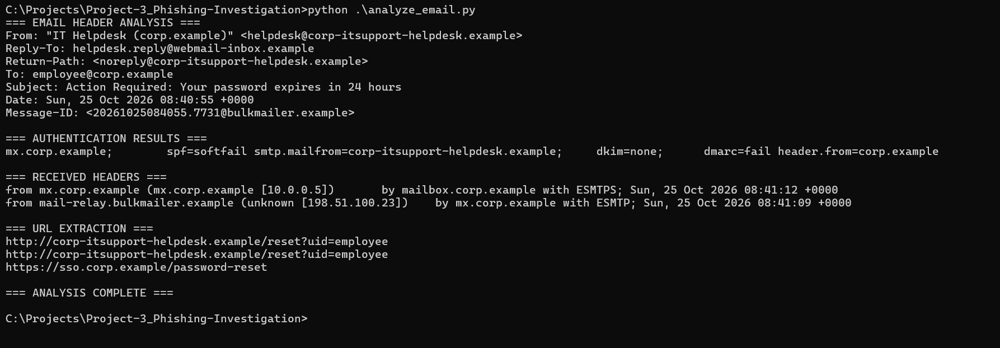

### IOC Extraction

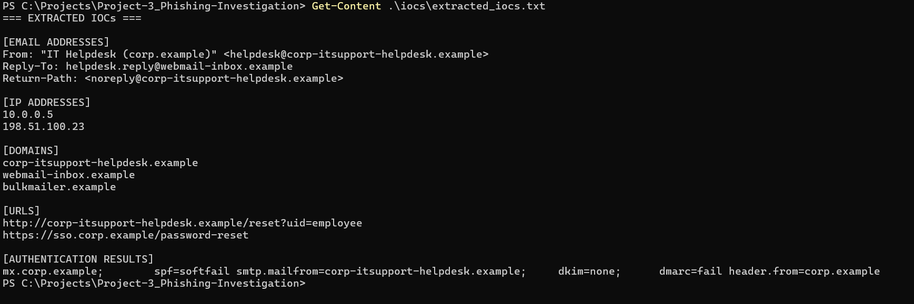

### IOC Enrichment

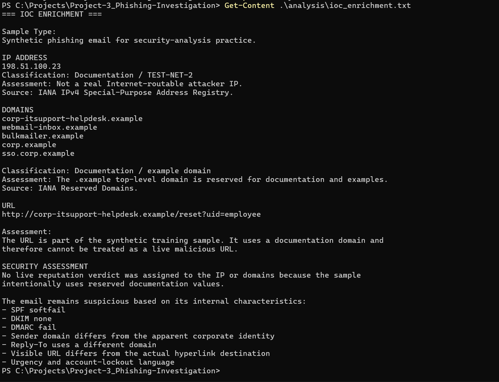

### Phishing Indicator Analysis

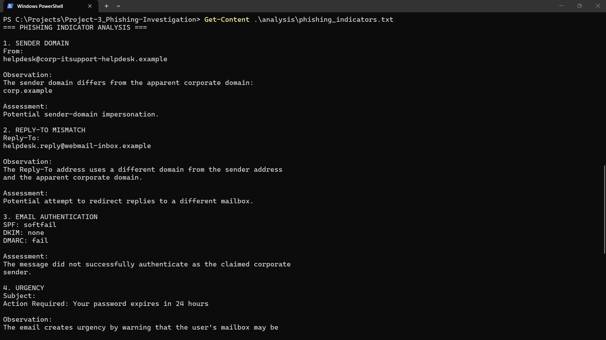

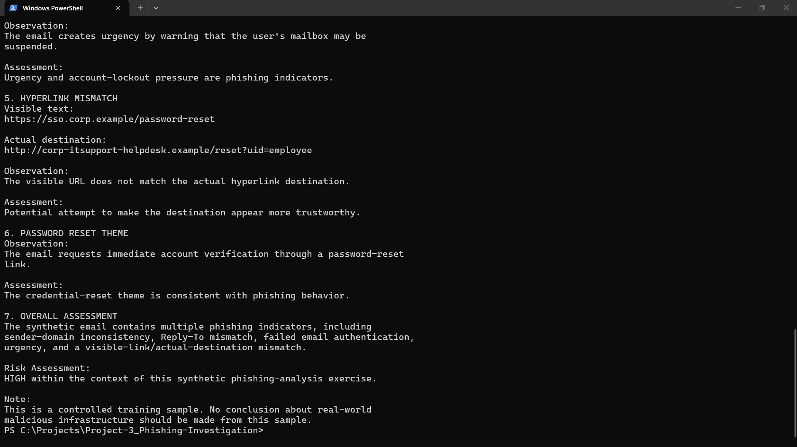

### MITRE ATT&CK Mapping

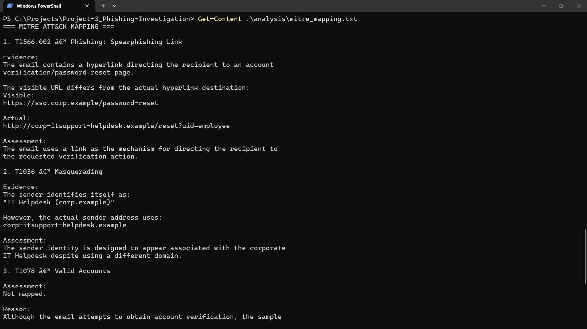

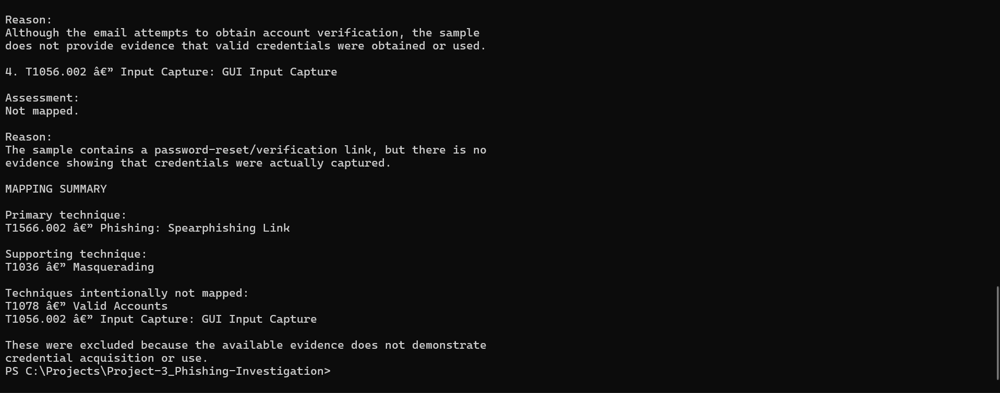

### Investigation Report

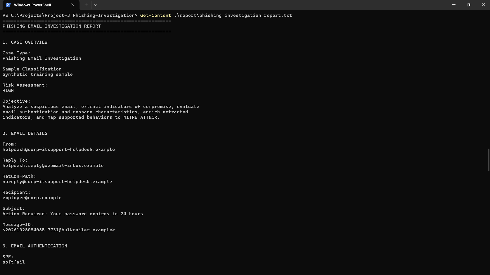

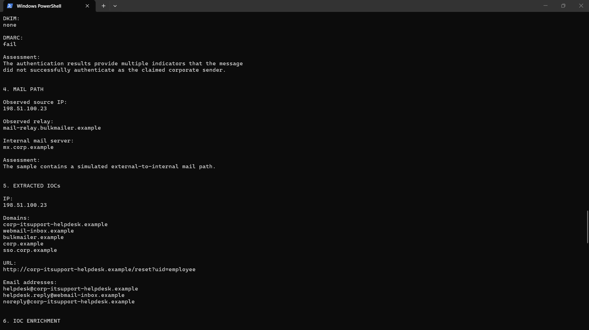

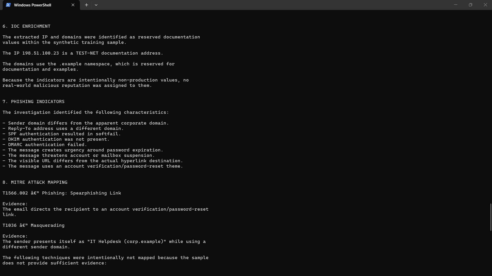

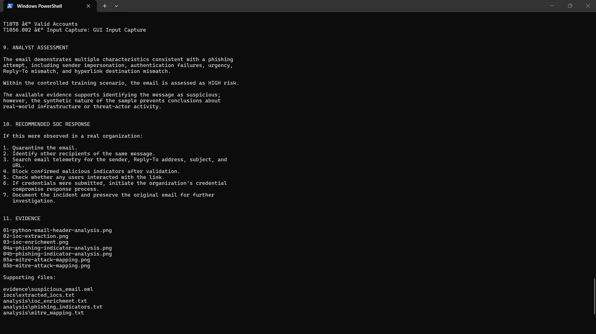

## Project Structure

```text
Project-3_Phishing-Investigation/
│
├── analyze_email.py
├── extract_iocs.py
├── README.md
│
├── analysis/
│   ├── ioc_enrichment.txt
│   ├── phishing_indicators.txt
│   └── mitre_mapping.txt
│
├── evidence/
│   └── suspicious_email.eml
│
├── iocs/
│   └── extracted_iocs.txt
│
├── report/
│   └── phishing_investigation_report.txt
│
└── screenshots/
    ├── 01-python-email-header-analysis.png
    ├── 02-ioc-extraction.png
    ├── 03-ioc-enrichment.png
    ├── 04a-phishing-indicator-analysis.png
    ├── 04b-phishing-indicator-analysis.png
    ├── 05a-mitre-attack-mapping.png
    ├── 05b-mitre-attack-mapping.png
    ├── 06a-phishing-investigation-report.png
    ├── 06b-phishing-investigation-report.png
    ├── 06c-phishing-investigation-report.png
    └── 06d-phishing-investigation-report.png
```

## Skills Demonstrated

- Phishing email analysis
- Email header investigation
- IOC extraction
- Python-based security analysis
- Threat-intelligence enrichment
- Phishing detection
- MITRE ATT&CK mapping
- SOC investigation documentation
- Evidence preservation and reporting

## Disclaimer

This project was conducted using a synthetic phishing email for educational and portfolio purposes. No real malicious infrastructure was contacted or interacted with during the investigation.